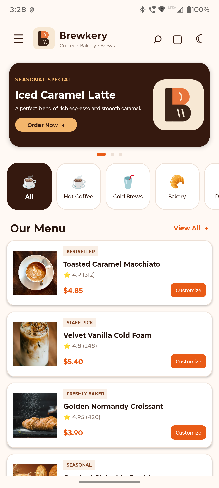
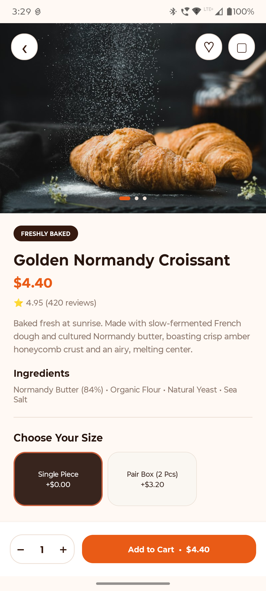
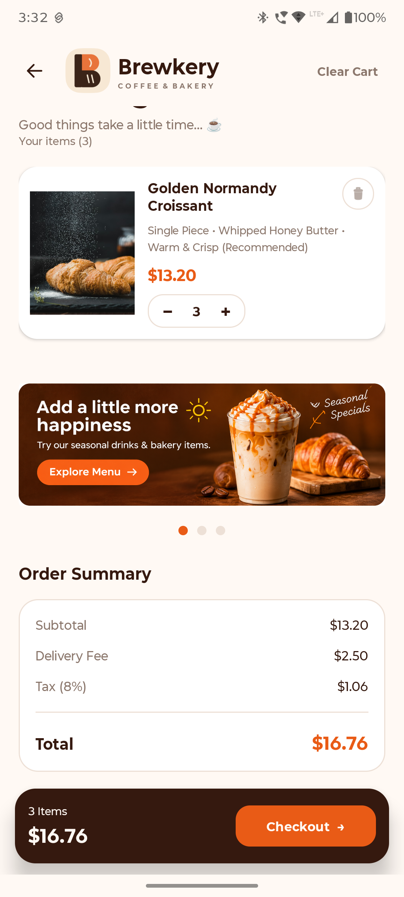
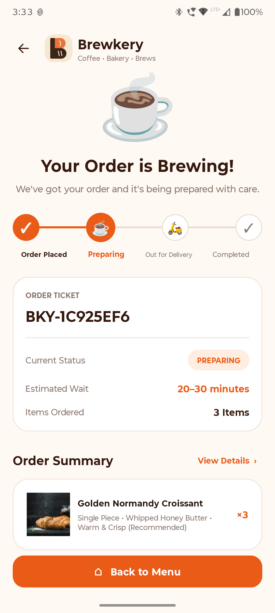
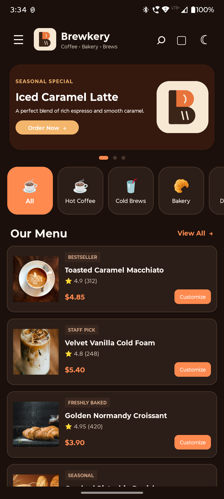
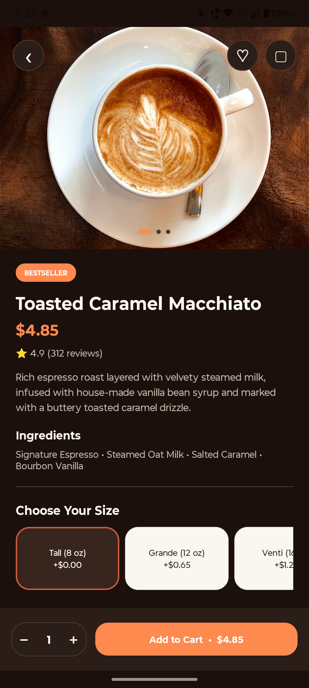

<div align="center">


# BREWKERY

### Coffee • Bakery • Brews

**Your Daily Dose of Coffee, Crafted Digitally.**

A modern Android coffee and bakery ordering application built with Kotlin and XML, delivering a premium experience for product discovery, drink customization, cart management and order tracking.

<br/>


<br/>

**[Explore Repository](https://github.com/HarshHarachkar/Brewkery)**

</div>

---

## 📖 About Brewkery

Brewkery is a modern Android coffee and bakery application designed to make ordering your favourite beverages and freshly baked products simple and enjoyable.

Users can explore a curated menu, discover seasonal promotions, customize drinks according to their preferences, manage their shopping cart and track their orders.

The application combines a premium coffee-inspired design with dynamic pricing, REST API integration and a modular Android architecture.

**Built with Kotlin. Designed for coffee lovers.**

---

## ✨ Key Features

| Feature | Description |
|:---|:---|
| 🏠 **Home Screen** | Explore featured products, categories and promotional banners. |
| ☕ **Product Catalog** | Browse coffee, cold brews, bakery and desserts. |
| 📋 **Product Details** | View product photography, descriptions, ingredients and ratings. |
| 🎨 **Customization** | Select drink sizes, milk options and sugar levels. |
| 💰 **Dynamic Pricing** | Automatically calculate prices based on selected customizations. |
| 🛒 **Shopping Cart** | Add, remove and manage products with quantity controls. |
| 🧾 **Checkout** | Calculate subtotal, delivery charges and estimated taxes. |
| 📦 **Order Management** | Generate unique order ticket IDs and display order status. |
| 🚚 **Order Tracking** | View the current order preparation status. |
| 🌙 **Theme Support** | Switch between light and dark themes. |
| 🌐 **REST API** | Retrieve menu, store configuration and product information. |

---

## 📱 Application Screenshots

The following screenshots showcase Brewkery's visual design and user experience.

<div align="center">

### 🏠 Home Screen

Explore featured promotions, product categories and the coffee menu.



<br/><br/>

### ☕ Product Details

Discover product information and personalize your favourite beverage.



<br/><br/>

### 🛒 Shopping Cart

Review selected products, manage quantities and view the complete order summary.



<br/><br/>

### 📦 Order Tracking

View your order ticket, estimated waiting time and preparation status.



<br/><br/>

### 🌙 Dark Theme

Experience Brewkery with its alternative dark appearance.





</div>

---

## 🛠️ Technology Stack

| Technology | Implementation |
|:---|:---|
| **Kotlin** | Primary programming language |
| **XML** | Native Android UI development |
| **ViewBinding** | Type-safe view interaction |
| **Retrofit** | REST API communication |
| **Gson** | JSON serialization and parsing |
| **Kotlin Coroutines** | Asynchronous operations |
| **RecyclerView** | Dynamic product and cart lists |
| **Glide** | Image loading and caching |
| **Material Components** | UI components and styling |
| **MVVM** | Presentation architecture |
| **JUnit** | Unit testing |

---

## 🌐 REST API Integration

Brewkery uses the REST API provided as part of the developer assignment.

### 1. Menu & Store Configuration

Retrieves store information, delivery charges, categories and product listings.

```http
GET https://raw.githubusercontent.com/VivekShah138/Brewkery/main/data.json
```

### 2. Individual Product Details

Retrieves detailed information about a specific product.

```http
GET https://raw.githubusercontent.com/VivekShah138/Brewkery/main/api/items/{id}.json
```

### API Implementation

- Retrofit for HTTP requests.
- Gson for JSON parsing.
- Coroutines for background operations.
- Glide for remote image loading.
- Loading and error states for network operations.

---

## 💰 Pricing & Checkout

Brewkery calculates order totals dynamically based on selected products, quantities and customizations.

| Component | Calculation |
|:---|---:|
| Subtotal | Product price × quantity |
| Delivery Fee | $2.50 |
| Estimated Tax | 8% |
| **Total Payable** | **Subtotal + Delivery + Tax** |

All calculations are handled dynamically as the cart changes.

---

## 🏗️ Project Architecture

The application follows a modular structure to maintain separation of responsibilities and simplify development.

```text
Brewkery/
│
├── app/
│   └── src/main/
│       │
│       ├── java/com/harsh/brewkery/
│       │   │
│       │   ├── adapter/
│       │   │
│       │   ├── data/
│       │   │   ├── model/
│       │   │   ├── remote/
│       │   │   └── repository/
│       │   │
│       │   ├── ui/
│       │   │   ├── home/
│       │   │   ├── details/
│       │   │   ├── cart/
│       │   │   └── order/
│       │   │
│       │   ├── utils/
│       │   │
│       │   └── MainActivity.kt
│       │
│       └── res/
│           ├── drawable/
│           ├── layout/
│           ├── mipmap/
│           ├── values/
│           └── xml/
│
├── docs/
│   ├── images/
│   │   └── brewkery-logo.png
│   │
│   └── screenshots/
│       ├── home.png
│       ├── product-details.png
│       ├── cart.png
│       ├── order-status.png
│       ├── dark-home.png
│       └── dark-cart.png
│
├── gradle/
│
├── README.md
└── build.gradle.kts
```

---

## ⚙️ Development Environment

| Configuration | Details |
|:---|:---|
| IDE | Android Studio |
| Language | Kotlin |
| UI Development | XML Layouts |
| Namespace | `com.harsh.brewkery` |
| Minimum SDK | Android 6.0 (API 23) |
| Compile SDK | Android API 36 |
| Build System | Gradle (Kotlin DSL) |
| Architecture | MVVM / Repository-based |

---

## 🚀 Getting Started

### Prerequisites

- Android Studio
- Android SDK 23 or above
- JDK 11 compatible build environment
- Internet connection

### Installation

**1. Clone the repository**

```bash
git clone https://github.com/HarshHarachkar/Brewkery.git
```

**2. Open the project**

Open the cloned project directory in Android Studio.

**3. Sync Gradle**

Allow Android Studio to download the required dependencies and complete Gradle synchronization.

**4. Connect your device**

Connect an Android device using USB debugging or start an emulator.

**5. Run the application**

Click the Run button in Android Studio to build and launch Brewkery.

---

## 🤖 AI-Assisted Development

AI tools were used as development assistants throughout the project for planning, implementation guidance, debugging and code review.

### AI Tools Used

- **ChatGPT** – Architecture planning, UI/UX discussions, Kotlin implementation guidance and debugging.

### Actual Prompts Used

**Prompt 1 – Project Planning**

> Let's plan my new Android app project. Goal: Advanced Android Developer portfolio. Technology: Kotlin + XML.

**Prompt 2 – UI/UX Design**

> Finalize Brewkery UI/UX with a premium modern design, Light + Dark themes, large product photography and smooth micro-interactions.

**Prompt 3 – Development**

> Let's start building the Brewkery Home Screen using Android Studio, Kotlin, XML and ViewBinding.

### Bug Caught & Fixed

**Issue:** Gradle synchronization failed due to an invalid TOML version catalog definition in `libs.versions.toml`.

**Root Cause:** Incorrect TOML syntax and version catalog structure.

**Resolution:** Corrected the TOML structure and restored the required `[versions]`, `[libraries]` and `[plugins]` sections.

### How AI Assisted Development

- Explored Android architecture and implementation approaches.
- Planned reusable XML UI components.
- Investigated Gradle dependency and synchronization errors.
- Reviewed Kotlin implementation approaches.
- Assisted with debugging and understanding unfamiliar concepts.

**Development Approach:** AI-generated suggestions were reviewed, tested and adapted before being integrated into the application. The final implementation and debugging decisions were handled during development.

---

## 🧪 Testing

The following areas are covered by the testing plan:

- API response handling.
- Product customization calculations.
- Dynamic pricing.
- Cart quantity management.
- Subtotal, delivery and tax calculations.
- Network error handling.
- Order ticket generation.

---

## 📦 Submission

| Deliverable | Link |
|:---|:---|
| GitHub Repository | [Brewkery Repository](https://github.com/HarshHarachkar/Brewkery) |
| Debug APK | Add APK sharing link |
| Screen Recording | Add recording link (optional) |

---

## 👨‍💻 Developer

<div align="center">

### Harsh Harachkar

**BSc Information Technology | Android Developer**

Passionate about building modern Android applications using Kotlin and exploring innovative mobile experiences.

<br/>

<a href="https://github.com/HarshHarachkar">
  
</a>

<a href="https://www.linkedin.com/in/harshh1104/">
  
</a>

</div>

---

<div align="center">

### ☕ Brewkery

**Crafted for Coffee Lovers.**

*Designed with passion. Developed with Kotlin.*

</div>
